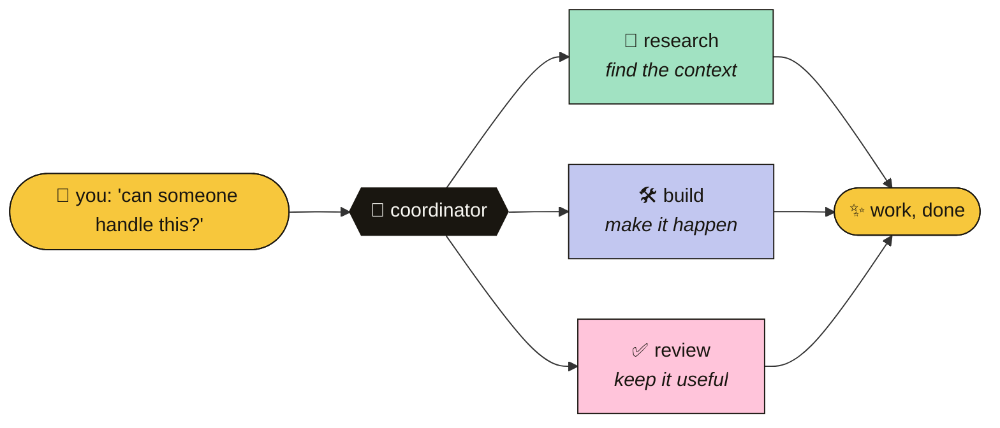

<p align="center"><i>~ my name is ~</i></p>

<h1 align="center">✳ RAYANDIKA ✳</h1>

<p align="center">
  
  
  
</p>

<p align="center">
  
</p>

---

### 👋 about me!

```ts
const rayandika = {
  role:    "AI Agent Engineer",
  based:   "Bandung, Indonesia 🇮🇩",
  now:     "leading engineering @ Potenlab, building multi-agent systems",
  before:  "4+ years shipping software (web, mobile, payments, maps)",
  builds:  ["AI agent teams", "workflows that do the work", "software that holds it together"],
  fuel:    ["☕", "neovim", "way too many agent tabs"],
  motto:   "less, but better.",
};
```

I build **AI teams that make work flow**: specialized agents that split a job, hand off tasks, call real tools, and finish it, with a human checkpoint where it matters. Thoughtful interfaces and reliable software are still at the heart of everything I build.

---

### 🧩 how I can help

<table>
  <tr>
    <td width="33%" valign="top">
      <h4>🟨 01 · AI agent teams</h4>
      Specialized agents that coordinate, delegate tasks, and work toward one shared business outcome.
      <br/><br/><sub><code>multi-agent orchestration</code></sub>
    </td>
    <td width="33%" valign="top">
      <h4>🟩 02 · workflows that do the work</h4>
      Agents wired into your tools and data, with evaluation and human checkpoints where needed.
      <br/><br/><sub><code>tools & automation</code></sub>
    </td>
    <td width="33%" valign="top">
      <h4>🟪 03 · software that holds it together</h4>
      Full-stack apps and integrations that turn an agent workflow into a product people actually use.
      <br/><br/><sub><code>full-stack development</code></sub>
    </td>
  </tr>
</table>

---

### 🤖 what an agent team looks like (roughly)



---

### 🗂️ some things I've made

| | project | what it is | built with |
|:-:|---|---|---|
| 📁 01 | **[Harness Agent Canvas](https://github.com/mrayandika15/harness-agent-canvas)** | Design an agent's steps on a node canvas, trigger it from chat, watch tool output stream back. | Next.js · TypeScript · React Flow · Zustand |
| 📁 02 | **IPMS + INTI PAY** | Corporate site, CMS, and an online payment point for a Bandung manufacturing company. | React · Express · PostgreSQL |
| 📁 03 | **Soccer Chief** | Online field booking for a Jakarta mini soccer venue, led end to end. | Next.js · Express · MongoDB |

<details>
<summary>🎈 <b>playground</b> <i>(small things, just for fun)</i></summary>
<br/>

- 🍜 **[Korean Halal Map](https://github.com/mrayandika15/korean-halal-map)**: a map for finding halal food in Korea.
- ✅ **[A little less to-do](https://github.com/mrayandika15/todo-list-knitto)**: a tiny task list, an exercise in making small interactions feel easy.
- ⌨️ **[my-neovim-config](https://github.com/mrayandika15/my-neovim-config)**: where I actually live.

</details>

👉 the full tour lives at **[mrayandika15.github.io/rayandika](https://mrayandika15.github.io/rayandika/)**

---

### 🧰 a few things in my toolbox

**agents & AI**


**the engineering that makes it hold up**


---

<details>
<summary>🎲 <b>random facts</b> <i>(click if you're curious)</i></summary>
<br/>

- 🏆 Won **1st prize** in a national energy-efficient architecture design competition (Ministry of Energy, 2016), before I ever wrote an agent.
- 💡 Built an **IoT energy-efficient building system** with Intel Indonesia back in 2015.
- 🐙 On GitHub since **2016**. Some of those early repos are... character building.
- 🇮🇩 Part of **FDE Indonesia**, forward deployed engineers.
- 📝 Favourite reminder, in big letters: **LESS, BUT BETTER.**

</details>

---

### ⌘ commit activity

<picture>
  <source media="(prefers-color-scheme: dark)" srcset="https://raw.githubusercontent.com/mrayandika15/mrayandika15/output/pacman-contribution-graph-dark.svg">
  <source media="(prefers-color-scheme: light)" srcset="https://raw.githubusercontent.com/mrayandika15/mrayandika15/output/pacman-contribution-graph.svg">
  
</picture>

---

### 💬 let's talk

Have a workflow to automate or an agent team to build? Let's connect the tools, the people, and the software.

<p>
  <a href="https://www.upwork.com/freelancers/~013f1d1af195891734"></a>
  <a href="https://mrayandika15.github.io/rayandika/"></a>
</p>

<p align="center"><sub><i>small pieces, big possibilities ✳</i></sub></p>
